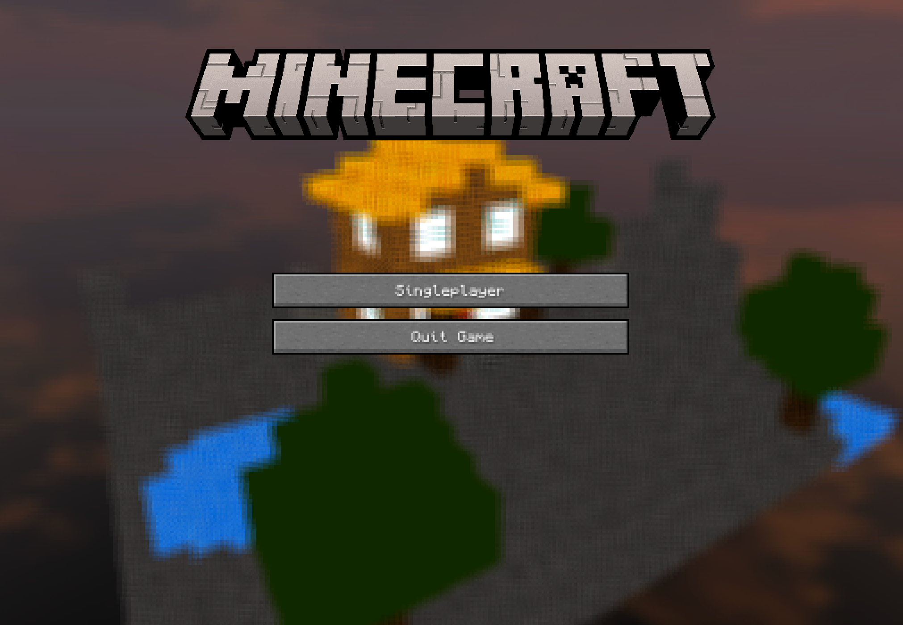
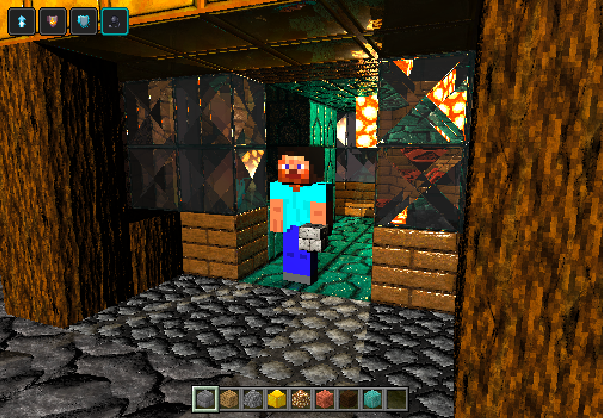
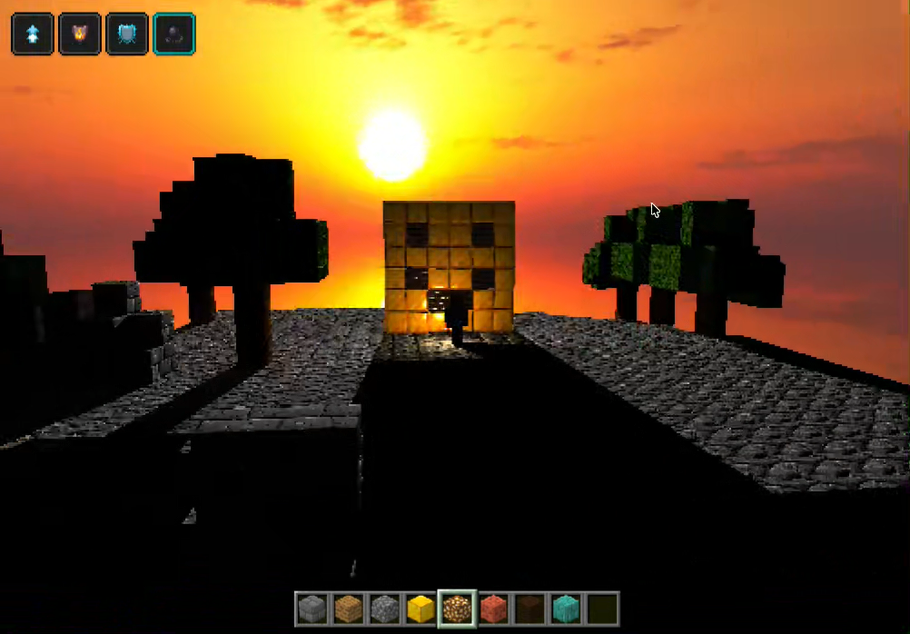

# CC2018 — Proyecto 2

Diorama voxel interactivo renderizado mediante ray tracing en CPU. La escena combina terreno procedural, una casa, árboles, un personaje animado, materiales avanzados y colocación de bloques.

Demo del proyecto: <https://youtu.be/jiPI8PnKe00>

## Capturas







## Ejecución

```bash
cargo run --release
```

Para notar todos los efectos de la rúbrica se debe usar el modo de renderizado **4 — Full**.

## Controles

- `W`, `A`, `S`, `D`: mover al personaje respecto a la cámara.
- `Espacio`: saltar.
- Flechas izquierda/derecha: recorrer la hotbar.
- `P`: colocar el bloque seleccionado debajo del personaje.
- `O`: eliminar un bloque colocado manualmente.
- Flechas arriba/abajo: cambiar la música.
- Arrastrar con clic izquierdo: rotar la cámara.
- Arrastrar con clic derecho: desplazar la cámara.
- Rueda del mouse: acercar o alejar la cámara.
- `R`: recentrar la cámara.
- `1`–`4`: Flat, Normals, Basic Light y Full.

## Cumplimiento de la rúbrica

| Criterio | Evidencia visible e implementación |
| --- | --- |
| Complejidad | Mundo voxel de `32 × 16 × 32`, casa, árboles, agua, personaje animado, colisiones, salto y construcción/destrucción de bloques. |
| Apariencia | Texturas propias por bloque, iluminación, sombras, skybox, animaciones, interfaz estilo Minecraft y pantalla de inicio con transición de cámara. |
| Paralelismo y optimización | El framebuffer divide filas entre los hilos disponibles del CPU. |
| Rotación y zoom | La cámara orbita con clic izquierdo, se acerca con la rueda y rota automáticamente detrás de la pantalla de inicio. |
| Cinco materiales | Brick, copper, white glass, ice y glowstone tienen texturas diffuse/normal/specular y parámetros propios. Se usan en el terreno, casa, agua y luces. |
| Refracción | Las ventanas usan un índice de refracción, Fresnel y rayos transmitidos recursivos. |
| Reflexión | El hielo de los estanques usa reflexión alta y rayos secundarios que reflejan la escena o el skybox. |
| Mapas normales | Los materiales transforman sus normal maps mediante tangente y bitangente antes de calcular la iluminación. |
| Material emisivo | Glowstone emite luz, ilumina la escena y también puede colocarse desde la hotbar. |
| Skybox | Se muestrea esféricamente para el fondo y para los rayos reflejados o refractados. |
| Terreno procedural | Se genera un área de `32 × 32` columnas con alturas, estanques, vegetación y estructuras, supera el mínimo de `16 × 16`. |

## Materiales destacados

El arreglo de albedo usa el orden `[difuso, especular, reflexión, refracción]`.

| Material | Albedo | Exponente especular | Uso visible |
| --- | --- | ---: | --- |
| Brick | `[0.95, 0.05, 0.00, 0.00]` | 6 | Relieve del terreno y hotbar. |
| Copper | `[0.35, 0.55, 0.15, 0.00]` | 90 | Detalles de la casa y hotbar. |
| White glass | `[0.00, 0.50, 0.10, 0.80]` | 125 | Ventanas refractivas de la casa. |
| Ice | `[0.00, 10.00, 0.95, 0.00]` | 1425 | Superficie reflectiva de los estanques. |
| Glowstone | `[1.00, 0.00, 0.00, 0.00]` | 1 | Iluminación emisiva y bloque colocable. |

## Restricciones técnicas

Todos los rayos, intersecciones, sombras, iluminación, reflexión, refracción, BVH y generación procedural se calculan en CPU mediante código propio en Rust. No se utilizan shaders ni una API 3D para calcular la escena. Raylib presenta el framebuffer ya calculado y gestiona ventana, entrada y audio. `image` se limita a decodificar texturas.
